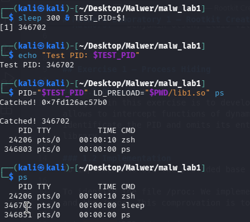
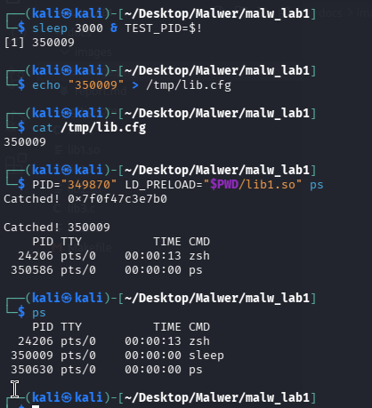
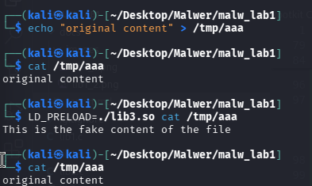
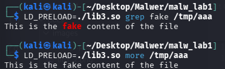

# Malware Laboratory 1 — Rootkit Creation

**Course:** Malware  
**Authors:** Benjamin Olsen, Lluís Vila

---

## Exercise 1 — Process Hiding

### 1.1 Objective

The goal of this exercise is to develop a library that can hide a specific process from the `ps` command. To achieve this, we use `LD_PRELOAD`, which allows us to intercept functions from dynamic libraries. In this case, we intercept `readdir()`, which is used to read directory entries in Linux.

The library identifies the target PID and skips its entry while reading the `/proc` directory. In this way, the process does not appear in the `ps` output when the library is loaded.

### 1.2 Implementation

For the implementation, we used the provided base code.

**Identification of the `/proc` directory**

We implemented the function `is_proc()`, which uses `dirfd()`, `fstat()` and `stat()` to obtain and compare the inode numbers of the current directory and `/proc`. This check helps prevent hiding files that are not inside `/proc`.

```c
int is_proc(DIR *dirp) {
    struct stat a, b;
    fstat(dirfd(dirp), &a);
    stat("/proc", &b);
    return a.st_ino == b.st_ino;
}
```

**PID configuration**

We implemented three ways to select the target process: a hardcoded PID (`174618`), an environment variable (`PID`) and a configuration file (`/tmp/lib.cfg`).

A priority system is applied: the configuration file has the highest priority, followed by the environment variable and finally the hardcoded PID.

**Process filtering**

Within the intercepted `readdir()` function, the name of the retrieved entry is compared with the configured PID using `strcmp()`. If the entry belongs to `/proc` and matches that PID, the next entry is requested and returned instead.

### 1.3 Testing and Results

To verify the correct operation of `lib1.so`, we performed two different tests.

**Process hiding using an environment variable**

In the first test, we created a `sleep 300` process and obtained its PID (`346702`). Then, we executed `ps` with the library loaded through `LD_PRELOAD`, using the previously identified PID as an environment variable.

As shown in Figure 1, the process does not appear in the list when the library is used. However, when we execute `ps` normally, the process appears in the terminal. This confirms that the process is still active and that the library only affects its visibility in the command output.



*Figure 1. Comparison of ps output with and without LD_PRELOAD, showing the hiding of PID 346702.*

**Configuration file priority**

In the second test, we created another `sleep 300` process with PID `350009` and saved this value in `/tmp/lib.cfg`.

Then, we executed `ps` with the library loaded and also set the environment variable `PID=349870`, which is different from the PID stored in the file.

As shown in Figure 2, the library hides process `350009`. This confirms that the configuration file has higher priority than the environment variable. When we execute `ps` normally, the process appears again.



*Figure 2. Verification that /tmp/lib.cfg takes precedence over the PID environment variable.*

### 1.4 Difficulties and Solutions

One of the main challenges was avoiding false positives. Since `readdir()` is used to read many directories, filtering only by PID could also hide normal files with the same name. To reduce this problem, we implemented `is_proc()`, which identifies `/proc` by comparing inode numbers.

---

## Exercise 2

<!-- Exercise 2 will be added here. -->

---

## Exercise 3 — In-Memory File Content Spoofing

### 3.1 Objective

The goal of this exercise is to make programs read content that is different from the original file. The main difference between Exercises 2 and 3 is that Exercise 2 uses a fake file stored on disk, whereas Exercise 3 stores the fake content in memory.

The library must work with `cat`, `grep` and `more` without modifying the original file `/tmp/aaa`.

### 3.2 Implementation

For this exercise, we divided the implementation into different parts.

**Identification of the target file**

To identify the target file, we use the functions `getinodev()` and `getinodevat()`, which obtain the inode and device numbers using `stat()` and `fstatat()`. Then, we compare these values with those of `/tmp/aaa` to check if the requested file is the target.

```c
target_ready = (getinodev("/tmp/aaa", &target_ino, &target_dev) == 0);
```

**Creating the fake file in memory**

We implemented the function `create_fake_file()`, which uses `memfd_create()` to create an anonymous file in memory. Then, we use `write()` to store the text defined in `fake_content`.

After writing the content, we use `lseek()` to move the cursor back to the beginning of the file, so it can be read correctly. Finally, the function returns the file descriptor.

**Intercepting open() and openat()**

We modified `open()` and `openat()` to check if the requested file matches the target file and if it is opened in read-only mode.

If both conditions are true, the functions return the file descriptor created by `create_fake_file()`, instead of opening the original file. Otherwise, the original functions are called normally.

**Intercepting fopen()**

We also modified `fopen()` to work with the fake file. Since `create_fake_file()` returns an integer file descriptor and `fopen()` must return a `FILE *`, we used `fdopen()` to convert the descriptor into a file stream.

This allows programs that use `fopen()` to read the fake content.

### 3.3 Testing and Results

To verify the correct operation of `lib3.so`, we performed two different tests.

**Original and fake content comparison**

In the first test, we created the file `/tmp/aaa` with the text `original content`. Then, we executed `cat` normally and obtained the original content.

After that, we executed the same command using `LD_PRELOAD` to load `lib3.so`. As shown in Figure 3, the output changed to the text defined in `fake_content`.

Finally, we executed `cat` again without the library and obtained the original content. This confirms that the original file was not modified.



*Figure 3. Comparison of cat output with and without LD_PRELOAD.*

**Verification using grep and more**

In the second test, we used the commands `grep` and `more` to check if the library also works with other programs.

As shown in Figure 4, both commands displayed the fake content when the library was loaded using `LD_PRELOAD`.

These results confirm that `lib3.so` works with the three commands tested: `cat`, `grep` and `more`.



*Figure 4. Verification of fake content using grep and more.*

### 3.4 Difficulties and Solutions

One of the main challenges was adapting `fopen()` to work with an anonymous file in memory. Since `memfd_create()` returns an integer file descriptor, we used `fdopen()` to convert it into a `FILE *`, which is required by `fopen()`.

Another important aspect was the position of the cursor after writing the fake content. To avoid reading from the end of the file, we used `lseek()` to move the cursor back to the beginning.

---

## Exercise 4
---

## Exercise Windows Case


---

## AI Usage Declaration

We used ChatGPT as a support tool during the laboratory to clarify concepts, review some technical aspects and improve the documentation.

All final work was reviewed by the group, and we take full responsibility for the submitted results.